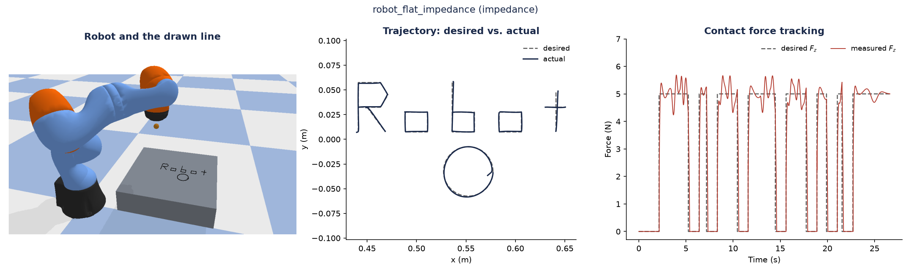
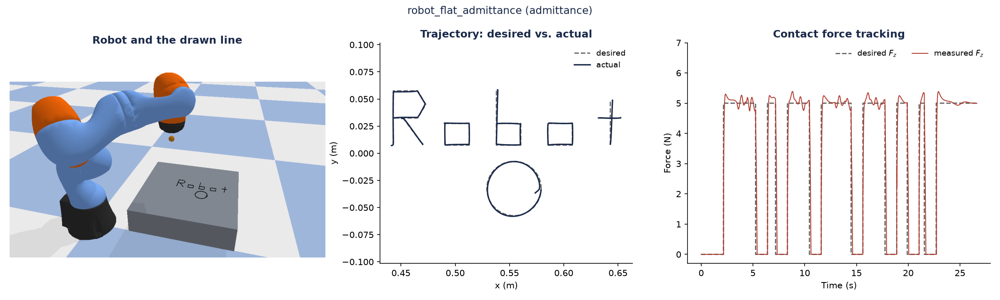
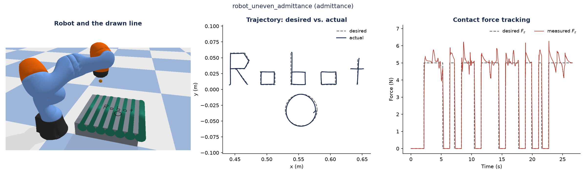
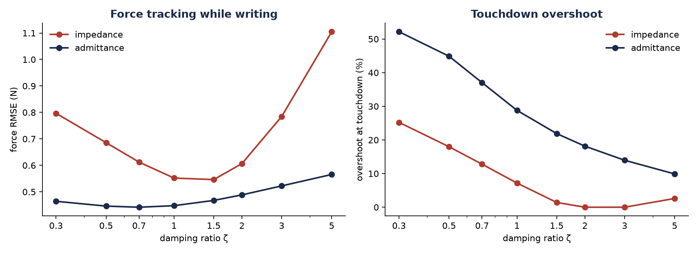
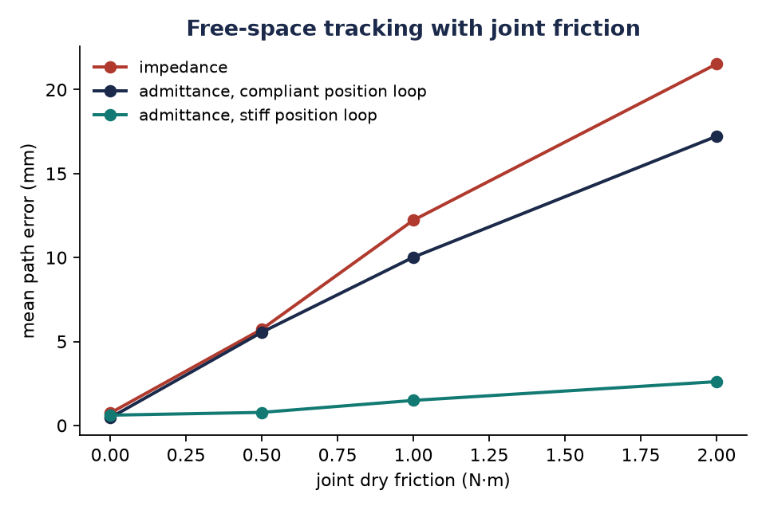
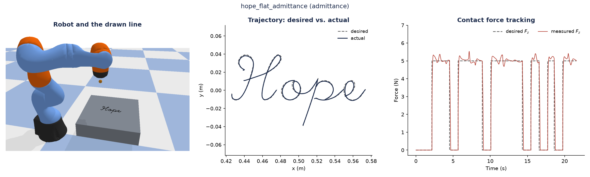
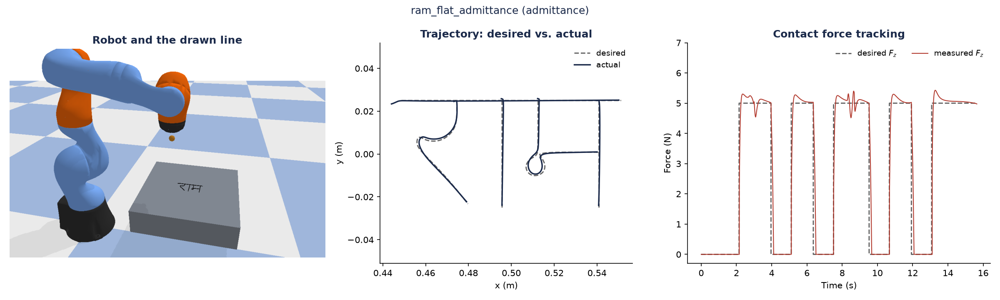

# Force-Controlled Robotic Writing

**Task:** a KUKA iiwa 7-DoF arm writes on a surface while holding a 5 N contact force, using impedance control and admittance control. PyBullet, joint-torque control at 1 kHz.

## Flat surface

Performed on a flat surface.

| Controller | Force RMSE | Mean force | Peak force |
|---|---|---|---|
| Impedance | 0.55 N | 4.93 N | 5.69 N |
| Admittance | 0.46 N | 4.99 N | 5.39 N |

## Uneven surface

Performed on a surface with 3 mm ridges every 6 cm.

| Controller | Force RMSE | Mean force | Peak force |
|---|---|---|---|
| Impedance | 0.80 N | 5.39 N | 6.98 N |
| Admittance | 0.50 N | 5.09 N | 6.27 N |

## Damping ratio

Performed on the flat surface (contact stiffness 750 N/m) writing "Robot" and a circle at 5 N. The damping ratio ζ of each controller was varied from 0.3 to 5, with all other settings fixed. Overshoot is measured at a single touchdown followed by a 3 s hold.

**Result:** impedance reaches zero overshoot only at ζ = 2 and 3; admittance still overshoots 10 % at ζ = 5 [7]. For impedance the surface spring acts in parallel with the controller spring, so the damping ratio in contact is lower than the set ζ (0.61 at ζ = 1.5).

| ζ | Impedance RMSE | Admittance RMSE | Impedance overshoot | Admittance overshoot |
|---|---|---|---|---|
| 0.3 | 0.80 N | 0.46 N | 25 % | 52 % |
| 0.5 | 0.69 N | 0.45 N | 18 % | 45 % |
| 0.7 | 0.61 N | 0.44 N | 13 % | 37 % |
| 1 | 0.55 N | 0.45 N | 7 % | 29 % |
| 1.5 | 0.55 N | 0.47 N | 1 % | 22 % |
| 2 | 0.61 N | 0.49 N | 0 % | 18 % |
| 3 | 0.78 N | 0.52 N | 0 % | 14 % |
| 5 | 1.10 N | 0.57 N | 3 % | 10 % |

## Free space with joint friction

Performed in free space: a 10 cm circle traced in the air.

**Result:** at 1 N·m joint friction, the 5000 N/m position loop is 8× more accurate than impedance [4].

Mean path error:

| Joint friction | Impedance | Admittance, 600 N/m position loop | Admittance, 5000 N/m position loop |
|---|---|---|---|
| 0 N·m | 0.7 mm | 0.5 mm | 0.6 mm |
| 0.5 N·m | 5.7 mm | 5.6 mm | 0.8 mm |
| 1 N·m | 12.2 mm | 10.0 mm | 1.5 mm |
| 2 N·m | 21.5 mm | 17.2 mm | 2.6 mm |

## Cursive writing

| Word | Impedance RMSE | Admittance RMSE |
|---|---|---|
| Hope | 0.58 N | 0.43 N |
| राम | 0.62 N | 0.53 N |

## Method

[PSEUDOCODE.md](PSEUDOCODE.md)

## References

1. N. Hogan, "Impedance Control: An Approach to Manipulation," *ASME J. Dyn. Syst. Meas. Control*, 1985.
2. B. Siciliano, L. Villani, *Robot Force Control*, Kluwer, 1999.
3. O. Khatib, "A unified approach for motion and force control of robot manipulators," *IEEE J. Robot. Autom.*, 1987.
4. C. Ott, R. Mukherjee, Y. Nakamura, "Unified Impedance and Admittance Control," *IEEE ICRA*, 2010. Their stiff-contact instability of admittance control was not observed here.
5. T. Flash, N. Hogan, "The coordination of arm movements," *J. Neuroscience*, 1985.
6. A. V. Hershey, script font (public domain), 1967; G. Chaikin, corner cutting, 1974.
7. K. Ogata, *Modern Control Engineering*, 5th ed., Prentice Hall, 2010.
